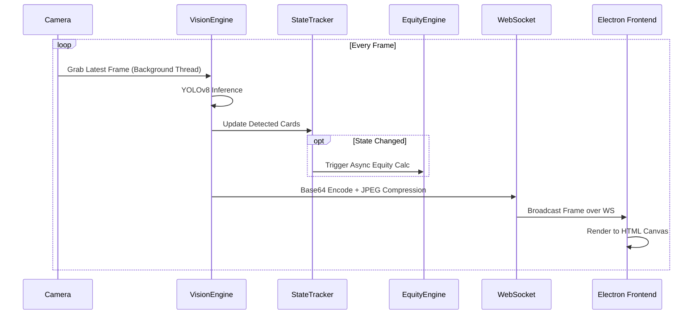
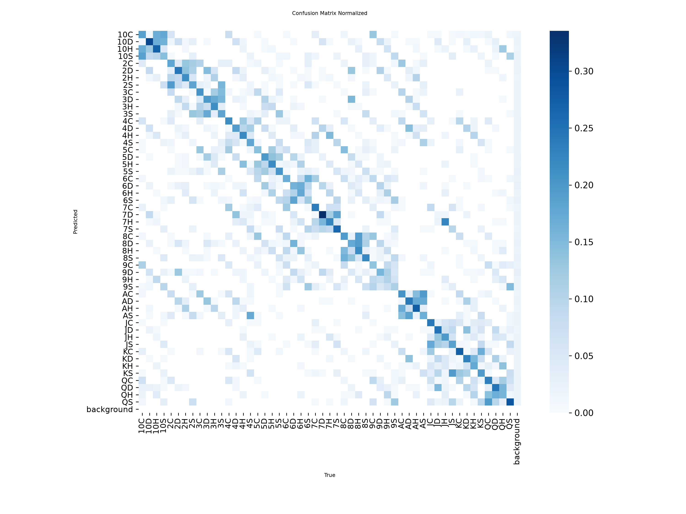
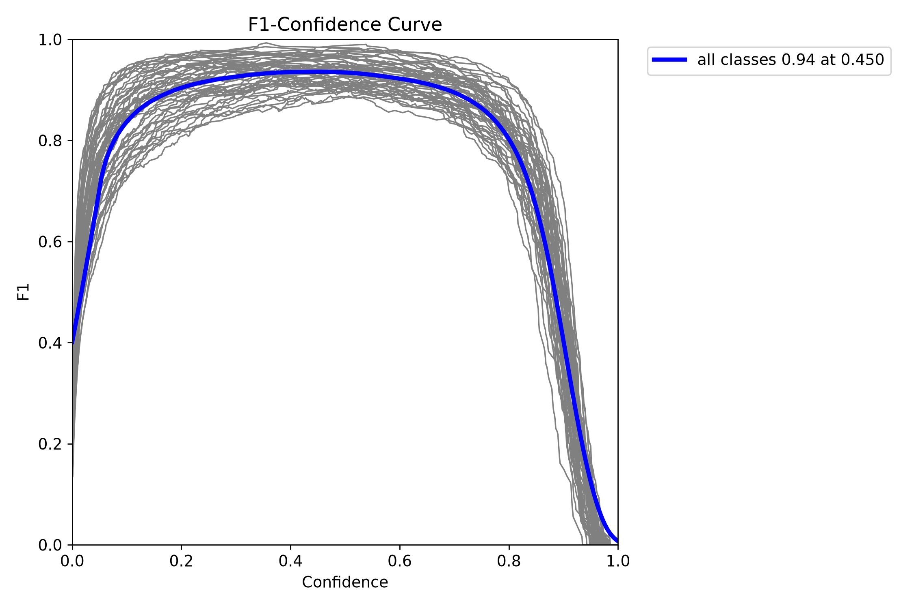
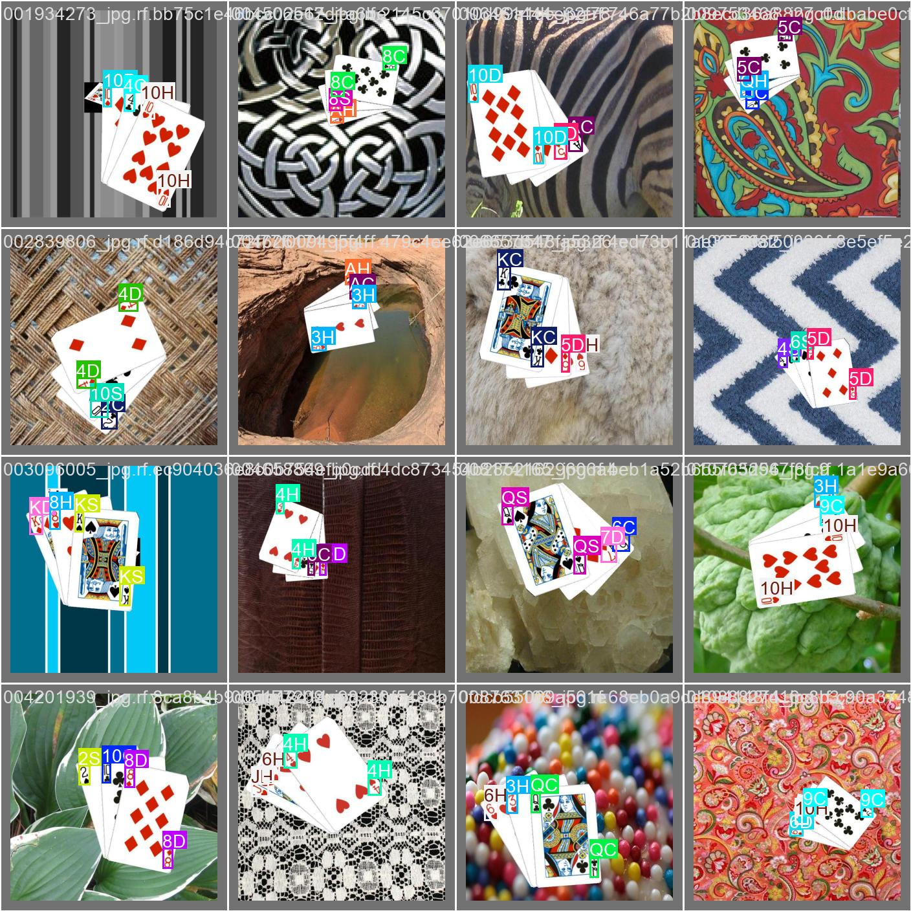

# Poker Computer Vision

pokerCV is a real-time, hardware-accelerated computer vision application designed to track physical poker cards, compute mathematical equity via Monte Carlo simulations, and provide instant solver recommendations. 

The application utilizes a distributed architecture, leveraging a lightweight Node.js/Electron frontend for the user interface and a robust Python backend for machine learning inference and state calculation.

## Architecture Overview

The system is split into two primary processes communicating over a local WebSocket connection. The Electron main process acts as the lifecycle manager, spawning the Python backend as a child process upon initialization.

## Core Technologies

### Frontend
* **Electron**: Wraps the application into a standalone desktop executable and manages native OS windowing.
* **Vanilla JavaScript, HTML, CSS**: Powers the user interface, utilizing the Canvas API for high-performance rendering of the base64-encoded JPEG frames sent by the backend.

### Backend
* **Python 3**: The core runtime for the backend processing pipeline.
* **OpenCV**: Handles camera hardware interfacing, background frame grabbing, and overlay rendering.
* **Ultralytics YOLOv8**: A state-of-the-art object detection model used to identify playing cards in real-time.
* **Treys**: A high-performance Python poker hand evaluation library used as the backbone for the Monte Carlo equity calculator.
* **WebSockets (asyncio)**: Facilitates low-latency, bidirectional communication between the Python pipeline and the Electron UI.

## Frame Processing Pipeline

To maintain low latency, the backend captures frames in a dedicated background thread. The main pipeline processes these frames synchronously, while heavy mathematical operations (like equity simulation) are offloaded to asynchronous background threads.



## Project Structure

* **`/backend`**: Contains all Python source code.
  * `server.py`: The WebSocket server and main loop coordinator.
  * `vision.py`: Manages the camera hardware and YOLO inference.
  * `state_tracker.py`: Implements debounce logic to filter out false-positive frame detections.
  * `equity.py`: Runs threaded Monte Carlo simulations using Treys.
  * `config.py`: Global configuration and zone definitions.
* **`/renderer`**: Contains all frontend web files.
  * `index.html`: The markup for the HUD interface.
  * `styles.css`: Premium dark mode styling and animations.
  * `app.js`: WebSocket client and Canvas rendering logic.
* `main.js`: The Electron entry point.
* `preload.js`: IPC bridge for secure communication between Electron and the renderer.

## Installation and Setup

1. **Install Node Dependencies**
   Navigate to the root directory and install the required Node packages:
   ```bash
   npm install
   ```

2. **Install Python Dependencies**
   Ensure Python 3 is installed, then install the required pip packages:
   ```bash
   pip install opencv-python ultralytics treys websockets
   ```

3. **Run the Application**
   Start the application using npm. This will automatically compile the frontend and spawn the Python backend:
   ```bash
   npm start
   ```

## What is Poker Equity?

Equity is the probability that a given hand will win (or split) the pot if the remaining community cards were dealt out. For example, a hand with 65% equity against its opponent's range is expected to win 65% of the time on average. pokerCV estimates equity by running thousands of Monte Carlo simulations per state change: it deals out random combinations of the remaining unseen cards, evaluates the resulting hands with Treys, and tallies the win/tie/loss rate to approximate the true win probability in real time.

## Action Recommendation Solver

The backend features an active solver that provides FOLD, CALL, or RAISE recommendations based on the calculated win probability against the community cards. 
* FOLD: Win probability under 40%
* CALL: Win probability between 40% and 64.9%
* RAISE: Win probability of 65% or greater

These thresholds are evaluated continuously and broadcasted to the frontend UI as soon as the community state changes.

## Model Evaluation

Below are the evaluation plots for the YOLOv8 model on the validation set:


### Confusion Matrix


### F1 Curve


### Validation Batch Labels

